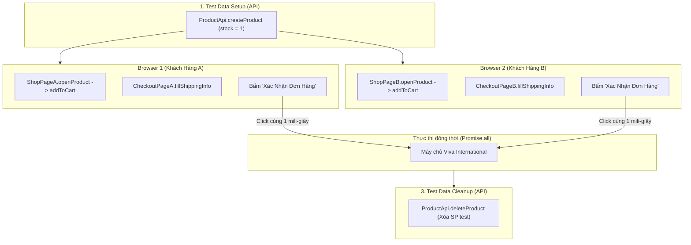

# Hướng Dẫn Thực Hành: Test Data Management (API) & UI Concurrency Mua Hàng (POM)

Tài liệu hướng dẫn hoàn chỉnh theo chuẩn kiến trúc **Page Object Model (POM)**:
- **Tầng API (Test Data Management)**: Chỉ chịu trách nhiệm tạo sản phẩm (`stock = 1`) trong `beforeAll` và xóa sản phẩm trong `afterAll`.
- **Tầng UI (Mua hàng thực tế trên Browser)**: Hai khách hàng ở hai trình duyệt độc lập mở sản phẩm, thêm vào giỏ, điền thông tin và cùng bấm nút "Xác Nhận Đơn Hàng" tại cùng một thời điểm.

---

## 1. Kiến Trúc 3 Tầng Chuẩn Page Object Model



---

## 2. Các Page Objects Được Bắt Bằng Playwright MCP

### 2.1. [`tests/pages/shopPage.js`](file:///c:/playwright_demo/tests/pages/shopPage.js)
```javascript
import { BasePage } from './basePage';

export class ShopPage extends BasePage {
    constructor(page) {
        super(page);
        this.addToCartButton = page.getByRole('button', { name: 'Thêm vào giỏ' });
        this.proceedToCheckoutButton = page.getByRole('button', { name: /Tiến hành thanh toán/i });
    }

    async openProduct(slug) {
        await this.navigateTo(`https://vivainternational.vn/product/${slug}`);
    }

    async addToCartAndCheckout() {
        await this.addToCartButton.click();
        await this.proceedToCheckoutButton.click();
    }
}
```

### 2.2. [`tests/pages/checkoutPage.js`](file:///c:/playwright_demo/tests/pages/checkoutPage.js)
```javascript
import { BasePage } from './basePage';

export class CheckoutPage extends BasePage {
    constructor(page) {
        super(page);
        this.nameInput = page.getByPlaceholder('Nguyễn Văn A');
        this.contactInput = page.getByPlaceholder('0901 234 567');
        this.emailInput = page.getByPlaceholder('email@vidu.com — để nhận thông báo đơn hàng');
        this.addressInput = page.getByPlaceholder('Số nhà, tên đường');
        this.wardInput = page.getByPlaceholder('Phường Bến Nghé');
        this.citySelect = page.locator('select[name="city"]');
        this.confirmOrderButton = page.getByRole('button', { name: 'Xác Nhận Đơn Hàng' });
    }

    async fillShippingInfo(customer) {
        await this.nameInput.fill(customer.user_info.name);
        await this.contactInput.fill(customer.user_info.contact);
        await this.emailInput.fill(customer.user_info.email);
        await this.addressInput.fill(customer.user_info.address);
        await this.wardInput.fill('Phường Bến Nghé');
        await this.citySelect.selectOption('TP. Hồ Chí Minh');
    }

    async confirmOrder() {
        await this.confirmOrderButton.click();
    }
}
```

---

## 3. Mã Kịch Bản Test: [`tests/concurrency-order.spec.js`](file:///c:/playwright_demo/tests/concurrency-order.spec.js)
Tầng kịch bản điều phối 2 browser độc lập, gọi Page Objects điền thông tin và kích hoạt nút đặt hàng đồng thời bằng `Promise.all`.
